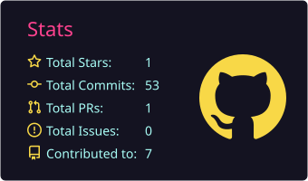
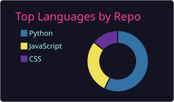

<!-- ========== BANNER ========== -->

  

  

  
  
  

---

## 🧑‍💻 Sobre mim

Sou o **Victor**, estudante de **Engenharia de Software** em São Paulo. Gosto de pegar uma tarefa repetitiva ou um processo confuso e transformar em algo que roda sozinho: um robô, um painel ou um sistema simples que alguém usa no dia a dia.

- 🤖 Construo **robôs de automação web** com Python + Playwright (coleta de dados, relatórios em Excel)
- 📊 Monto **dashboards e integrações** com Google Apps Script e bancos SQL
- 🌐 Desenvolvo **sites e landing pages** para pequenos negócios
- 📚 Estudando agora: arquitetura de software, banco de dados e mercado financeiro
- 🌍 Praticando inglês para trabalhar em projetos internacionais

> *"Escolha aquilo de que você vai se arrepender menos."* — **Levi Ackerman**, Attack on Titan
>
> Ninguém sabe como as coisas vão terminar. Então eu escolho aprender mais, codar melhor e evoluir um pouco todos os dias.

---

## 🛠️ Tecnologias

**Linguagens**
 

**Automação & Dados**
 

**Ferramentas**
 

---

## 📌 Projetos em destaque

| Projeto | O que faz | Stack |
|---|---|---|
| 💰 [**PriceBot**](https://github.com/PitsayCode/PriceBot) | Robô que coleta preços, classifica por faixa e gera Excel com gráficos. Interface moderna e cofre de contas criptografado (AES-256-GCM). | `Python` `Playwright` `Excel` |
| 🤖 [**Bot de Vendas**](https://github.com/PitsayCode/Bot_de_vendas-Produtos) | Faz login/cadastro num e-commerce, coleta preços de produtos e exporta um relatório em Excel. | `Python` `Playwright` `SQLite` |
| 🏃 [**Vida Ativa 60+**](https://github.com/PitsayCode/Vida-Ativa-60-) | Landing page de vendas de um e-book para o público 60+, com Meta Pixel e checkout integrado. | `JavaScript` `Vite` `HTML/CSS` |
| 🗃️ [**CRUD Python**](https://github.com/PitsayCode/CRUD_Pyton) | CRUD completo com banco SQL e separação de responsabilidades entre camadas. | `Python` `SQL` |
| 🐾 [**Site Petshop**](https://github.com/PitsayCode/Site_Petshop) | Site institucional para petshop. | `JavaScript` `HTML/CSS` |

---

## 📊 Estatísticas

  

  
  

---

## 🍥 Modo Anime ON

| Anime | Citação |
|---|---|
| **Naruto** | *"Pessoas crescem quando são capazes de superar as adversidades."* — Jiraiya |
| **One Piece** | *"Se você não arrisca, não pode criar um futuro."* — Monkey D. Luffy |
| **Attack on Titan** | *"Dediquem seus corações!"* — Erwin Smith |
| **My Hero Academia** | *"É bom ter um sonho impossível e tentar alcançá-lo."* — All Might |

